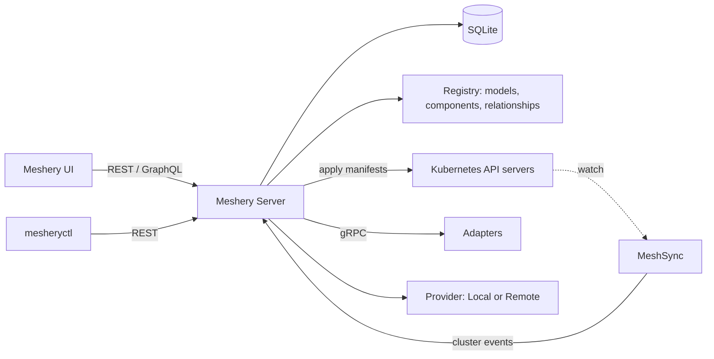

# アーキテクチャ

## 全体像

Meshery の中心は Meshery Server という 1 つのプロセスで、ほかはすべてそのクライアントか、そこへのデータ供給元である。UI と `mesheryctl` はその REST API と GraphQL API を呼ぶ。サーバは接続中の各 Kubernetes クラスタと kubeconfig で直接話し、クラスタの中身は MeshSync から知る。任意の adapter が gRPC でサーバを拡張し、Provider プラグインがユーザ、design、結果の保存先を決める。

ここから先のどのページにも出てくる用語が 2 つある。**model** は 1 つの技術 (Kubernetes 自体、Istio、あるクラウドサービス) を、**component** (JSON スキーマを持つリソース種別) と **relationship** (component どうしのつながり方。親子、2 者間のエッジ、第 3 の component を介したバインディング) の集合として記述する。**design** は利用者が書く文書で、component の宣言と relationship からなる。コードは design を今も `PatternFile` と呼ぶ。以前の名前「pattern」の名残である ([Logical Concepts](https://docs.meshery.io/concepts/logical))。

## コンポーネント

### Meshery Server

`server/` 以下の Go プロセス。UI を配信し、REST と GraphQL の API をポート 9081 で提供し、model のレジストリを持ち、design を評価して配備する ([Architecture docs](https://docs.meshery.io/concepts/architecture))。ルートは `server/router/server.go` で登録され、ハンドラは `server/handlers/` にある。

データベースは SQLite ファイルで、ユーザデータフォルダの `mesherydb.sql` である (`server/models/sql-utils.go:101-105`)。docs はこれを「ファイルに永続化する」が「キャッシュとして扱う」と説明している ([Architecture docs](https://docs.meshery.io/concepts/architecture))。

### Meshery UI と mesheryctl

UI (`ui/`) はサーバが配信する Next.js アプリケーションである。`mesheryctl` (`mesheryctl/`) は Cobra で作られた Go の CLI である。どちらも同じ REST API のクライアントで、`mesheryctl design apply` は UI と同じく `/api/pattern/deploy` に POST する (`mesheryctl/internal/cli/root/design/apply.go:82`)。

### MeshSync

MeshSync は Kubernetes リソースを発見し、サーバをそれと同期させる。接続ごとに 2 つのモードのどちらかで動く。既定の **embedded** モードでは、ライブラリとしてサーバプロセス内で動き、メモリ上のチャネルでイベントを渡す。**operator** モードでは、サーバがクラスタの `meshery` namespace に Meshery Operator、MeshSync、NATS broker を入れ、イベントは NATS を流れる (`server/models/connections/meshsync_deployment_mode.go:40-45`、`server/models/meshery_controllers.go:392-412`、[Quick Start](https://docs.meshery.io/installation/quick-start))。どちらの場合もサーバは同じハンドラでイベントを受け、データベースに書き込む (`server/models/meshsync_events.go:246-287`)。

### Adapter

adapter は特定の技術向けの独立した gRPC サービスで、meshery-istio や meshery-linkerd などがある。契約は `server/meshes/meshops.proto:7-16` の `MeshService` で、`ApplyOperation`、`Provision`、`StreamEvents` などの呼び出しを持つ。各 adapter は固有のポートで待ち受ける (Istio は 10000、Linkerd は 10001 など) ([Architecture docs](https://docs.meshery.io/concepts/architecture))。

### Provider

Provider は、ID 管理、設定、design と結果の永続化を受け持つプラグインである。`Provider` interface は `server/models/providers.go:579-780` にわたる。サーバは 2 つの実装を持つ。Local provider (`server/models/default_local_provider.go:43`、`:84` で名前は `"Local"`) と、外部サービスと HTTPS で話す Remote provider (`server/models/remote_provider.go:80`) である。

## リクエストの流れ

文書をクラスタ内のリソースに変える操作、design の配備 `POST /api/pattern/deploy` を追う。

1. **ルーティング。** このルートはハンドラを 4 つのミドルウェアで包む。provider、認証、セッション、Kubernetes context の順である。`POST` が配備、`DELETE` が配備解除 (`server/router/server.go:276-277`)。Kubernetes ミドルウェアは、ユーザが接続しているクラスタの context をリクエストの context に入れる。
2. **パース。** `PatternFileHandler` はリクエスト本文から design を読み、クエリフラグ `dryRun`、`skipCRD`、`verify`、`upgrade` を読む (`server/handlers/design_engine_handler.go:45-90`)。旧形式 `v1alpha2` の design は先に変換する (`:92-119`)。次に design をパースし、**hydrate** する。欠けている component の定義をレジストリから埋める処理である (`:121-131`)。
3. **クラスタの収集。** `_processPattern` はリクエストの context から認証トークンと Kubernetes context の一覧を取り出し、それぞれの kubeconfig を生成する (`design_engine_handler.go:209-231`)。
4. **ステージチェーンの実行。** design は `Format`、`Filler`、`Validator` を通り、次に `DryRun` か `Provision` のどちらかを通り、最後に component ごとの結果を集めるステップに入る (`design_engine_handler.go:257-297`)。
5. **計画。** `Provision` ステージは各 component の `dependsOn` リストから依存グラフを作り、循環のある design を拒否する (`server/models/pattern/stages/provision.go:39-58`、`server/models/pattern/planner/planner.go:95-142`)。配備解除のときは辺を逆向きにし、依存する側を先に処理する。
6. **並列実行。** グラフの各ノードは自分の goroutine で動き、すべての依存先から報告が届くまで待つ。依存先が 1 つでも失敗していれば、そのノードは実行されず withheld (保留) として報告され、失敗はそのノードに依存するノードへ伝わる (`server/models/pattern/planner/parallel_process.go:86-144`)。
7. **適用。** サーバは component ごとに `patterns.Process` を呼び、これが接続中のすべてのクラスタに並列で展開する。Kubernetes 以外の model の component では、先に CRD や operator などの前提物を入れてから `k8s.Deploy` を呼ぶ (`server/models/pattern/patterns/patterns.go:47-140`)。`k8s.Deploy` は component を Kubernetes のマニフェストに変換し、更新または削除の扱いで適用する (`server/models/pattern/patterns/k8s/k8s.go:24-45`)。
8. **報告。** ハンドラはイベントを記録し、component ごとの要約を JSON で返す (`design_engine_handler.go:168-197`)。

## 主要な設計判断

- **push を 1 回。** サーバが自分でリソースを適用して戻る。design を適用し続けるコントローラはないので、クラスタ側の drift は MeshSync を通して見えるが、自動では直らない。Git から pull してループで reconcile する GitOps ツールとの一番大きな違いである。
- **全クラスタに展開する。** 1 回の配備はユーザの接続中の context すべてに、クラスタごとに 1 つの goroutine で同時に送られる (`patterns.go:72-140`)。マルチクラスタ配備が標準の経路である。
- **すべての結果を残す。** provision ステージは、依存先の失敗で試されなかった component も含め、すべての component に結果を記録する (`provision.go:100-134`)。配備のレスポンスは常に、各部品に何が起きたかを伝える。
- **データベースは使い捨て。** SQLite はキャッシュしたクラスタ状態とレジストリを持つ。ユーザ、design、結果は Provider の持ち物なので、同じサーバをローカルの保存先でもリモートのサービスでも動かせる。
- **既定ではエージェントレス。** MeshSync が embedded なら、クラスタを接続しても中には何も入らない。operator モードは、発見処理をクラスタ内で動かす必要がある構成のためにある。

## 拡張ポイント

- **Model。** component と relationship の JSON を持つディレクトリを `models/` に追加する。サーバは起動時にすべての model ディレクトリを登録する (`server/models/seed_models.go:19`、`:155-175`)。ほとんどの統合はこの方法で追加される。
- **Adapter。** 技術固有の操作のために gRPC の `MeshService` 契約 (`server/meshes/meshops.proto:7-16`) を実装する。
- **Provider。** `Provider` interface (`server/models/providers.go:579-780`) を実装し、ID 管理と永続化を自前のサービスに任せる。
- **UI 拡張。** UI は実行時にリモートの React コンポーネントを読み込む ([AGENTS.md](https://github.com/meshery/meshery/blob/68d542afa9e40e15e3d032bf3ed1d10eb2347b62/AGENTS.md))。
