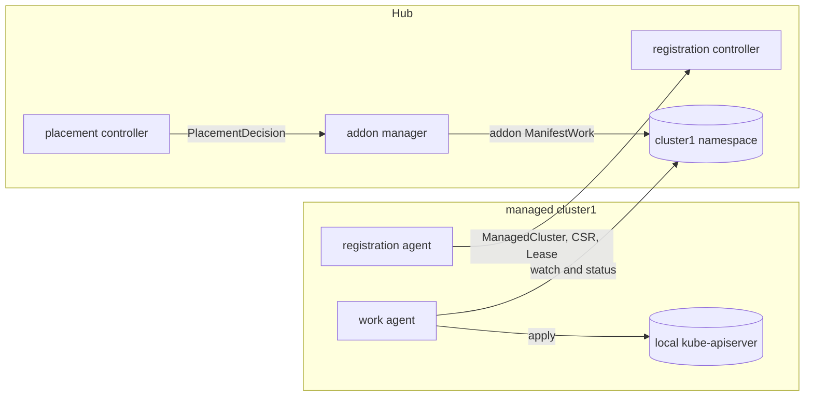

# アーキテクチャ

## 全体像

OCM には 2 つの側がある。hub は Cluster Manager (コントローラ群と CRD) が動く普通の Kubernetes クラスタ。各 managed cluster では klusterlet が動き、その中身は registration エージェントと work エージェントの 2 つ。エージェントが hub へ外向きに接続する。処理を届けるのに、hub が managed cluster の API サーバへ到達できる必要はない。

hub 上での分離の単位は、managed cluster ごとの namespace で、名前はクラスタ名と同じ。hub はクラスタを受け入れると、その namespace と、クラスタのエージェントがその中のオブジェクトを読み書きするための RBAC を作る (`pkg/registration/hub/managedcluster/controller.go:217-260`)。ManifestWork や ManagedClusterAddOn など、特定のクラスタ宛てのものはすべてその namespace に置く。work エージェントは自分の namespace だけを watch する (`pkg/work/spoke/spokeagent.go:257`)。

図にはあと 3 つ用語が出てくる。証明書署名要求 (CSR) は、エージェントが hub にクライアント証明書を求めるときに使う Kubernetes のオブジェクト。Lease は、エージェントがハートビートとして更新し続ける小さな `coordination.k8s.io` のオブジェクト。ManagedClusterAddOn は、あるクラスタで add-on が有効になっていることを表すクラスタごとの記録。

## コンポーネント

hub 側のコマンドは `pkg/cmd/hub/`、managed cluster 側は `pkg/cmd/spoke/` にある。どちらも通常は operator がインストールする。

### Registration

hub の registration コントローラは、クラスタの受け入れと拒否、クラスタごとの namespace と RBAC の作成、CSR の承認、各クラスタのハートビート lease の監視を行う。managed cluster 側では registration エージェントが hub 上に `ManagedCluster` オブジェクトを作り、クライアント証明書を取得・更新し、lease を更新し続け、クラスタの状態と claim を報告する (bootstrap の流れは `pkg/registration/spoke/spokeagent.go:88-116`、claim は `pkg/registration/spoke/managedcluster/claim_reconcile.go:33`)。資格情報の扱いは差し替え可能で、既定は CSR ドライバ、代わりに AWS IRSA と gRPC のドライバがある (`pkg/registration/register/factory/options.go:80-89`)。add-on エージェントは CSR か token で認証できる (`factory/options.go:24-26`)。

### Work

work エージェントは、hub 上の自分の namespace にある `ManifestWork` を managed cluster に適用し、状態を書き戻す。hub 側では `ManifestWorkReplicaSet` コントローラが、1 つの ManifestWork テンプレートを Placement が選んだ全クラスタへ rollout 戦略付きで展開する (`vendor/open-cluster-management.io/api/work/v1alpha1/types_manifestworkreplicaset.go:54-103`)。

### Placement

placement コントローラは `Placement` を読み、選ばれたクラスタ名を並べた `PlacementDecision` を書く (`pkg/placement/controllers/scheduling/scheduling_controller.go:214-284`)。自分では何もデプロイしない。利用側が決定を読んで動く。Placement から見えるのは、ManagedClusterSetBinding で自分の namespace に bind された ManagedClusterSet (名前付きのクラスタのグループ) の中のクラスタだけ (`vendor/open-cluster-management.io/api/cluster/v1beta1/types_placement.go:18-26`)。

### Add-on manager

add-on manager は、add-on エージェントのマニフェストを各クラスタの namespace の `addon-<name>-deploy-*` という ManifestWork に包んで managed cluster へ配る (`vendor/open-cluster-management.io/addon-framework/pkg/addonmanager/controllers/agentdeploy/default_sync.go:29-77`)。`manager` として動く (`pkg/cmd/hub/addon.go:20-21`)。add-on エージェントの hub 資格情報は managed cluster 側の registration エージェントが用意する。add-on ごとに資格情報ドライバのインスタンスを別に作り、その add-on 用の証明書を要求する (`pkg/registration/spoke/addon/registration_controller.go:223`)。

### Operator とインストールモード

cluster-manager operator は `ClusterManager` リソースから hub のコンポーネントをインストールする。klusterlet operator は `Klusterlet` リソースからエージェントをインストールする (`pkg/operator/operators/`)。klusterlet には Default、Hosted、Singleton、SingletonHosted の 4 モードがある。Singleton は registration と work を 1 つの deployment で動かす。Hosted はエージェントを別の management cluster で動かし、managed cluster には CRD と設定だけを置く (`vendor/open-cluster-management.io/api/operator/v1/types_klusterlet.go:407-416`)。

### gRPC サーバ

任意の hub バイナリ `server` ("Server for transport resources", `cmd/server/main.go:37-38`) を使うと、エージェントは hub の kube-apiserver を経由せず、gRPC で hub と ManifestWork などのリソースをやり取りできる。

## リクエストの流れ

登録が終わらないと work は流れない。以下の 2 つの流れはどちらも `cluster1` というクラスタを例にする。

### クラスタの登録

1. registration エージェントは bootstrap kubeconfig (hub に対する低権限の資格情報) を持って起動する。有効な hub kubeconfig がまだなければ、一時的な bootstrap コントローラを動かす (`pkg/registration/spoke/spokeagent.go:276-315`)。
2. そのコントローラは、hub にクラスタ名の `ManagedCluster` がなければ作り (`pkg/registration/spoke/registration/creating_controller.go:52-92`)、subject にクラスタ名とエージェント名を入れた CSR を出す。
3. hub 側では `validateCSR` が、CSR のクラスタラベル、organization、common name がすべて同じクラスタを指しているかを検査する (`pkg/registration/register/csr/approve_reconciler.go:133-201`)。参加済みのエージェントからの更新用 CSR は、要求者が証明書に書かれた主体と同じで、SubjectAccessReview が更新を許可すれば自動承認される (`approve_reconciler.go:60-90`)。初回の CSR が自動承認されるのは、alpha の `ManagedClusterAutoApproval` feature gate が有効で、要求者が自動承認リストに載っている場合だけ (`pkg/registration/register/csr/hub_driver.go:181-185`, `approve_reconciler.go:108-128`)。それ以外は hub 管理者が承認する。
4. hub 管理者が ManagedCluster の `spec.hubAcceptsClient: true` を設定する (`vendor/open-cluster-management.io/api/cluster/v1/types.go:64`)。すると hub のコントローラがクラスタの namespace、finalizer、クラスタ用の RBAC と role binding を作る (`pkg/registration/hub/managedcluster/controller.go:217-260`)。false に戻すと role binding を外し、クラスタを拒否済みにする (`controller.go:164-215`)。alpha の `ManagedClusterAutoApproval` gate が有効なら、クラスタの初回参加時に hub 自身が `hubAcceptsClient` を設定する (`controller.go:154-162`)。
5. 署名済み証明書を得たエージェントは、bootstrap コントローラを止めて本体のコントローラ群を起動する (`spokeagent.go:328-337`)。
6. 以後、エージェントは `leaseDurationSeconds` (既定 60) ごとに Lease を更新する (`pkg/registration/spoke/lease/lease_controller.go:67-81`)。その 5 倍の時間更新が見えないと、hub はクラスタの `ManagedClusterConditionAvailable` を Unknown にする (`pkg/registration/hub/lease/controller.go:27,115-157`)。

これが README の言う "double opt-in"。既定では、managed cluster の管理者は bootstrap 資格情報でエージェントを入れる必要があり、hub の管理者はクラスタを受け入れる必要がある ([README](https://github.com/open-cluster-management-io/ocm/blob/b4e4b232350d6967008372423e5aa7a967d80a9f/README.md))。

### ManifestWork の適用

1. 誰か (人、GitOps ツール、add-on manager、ManifestWorkReplicaSet コントローラ) が hub の namespace `cluster1` に ManifestWork を作る。
2. `cluster1` の work エージェントが namespace を絞った informer でそれを見つけ、`ManifestWorkController.sync` で reconcile する (`pkg/work/spoke/controllers/manifestcontroller/manifestwork_controller.go:132-211`)。
3. managed cluster 上に `AppliedManifestWork` を作るか更新する。この work が何を適用したかのローカルな記録 (`manifestwork_controller.go:213-240`)。
4. マニフェストを kind 順に並べ (namespace と CRD が最初、webhook が最後)、設定された update strategy でそれぞれ適用する (`manifestwork_reconciler.go:257-287,321-394`)。
5. マニフェストごとの `Applied` condition と、work 全体の `Applied` condition (`WorkApplied`) を hub に patch する (`manifestwork_reconciler.go:166-226`)。
6. 別の status コントローラが既定でおよそ 10 秒ごと (10 秒に最大 90% のジッター) に適用済みリソースを読み、選んだフィールドを status feedback として書き戻す (`pkg/work/spoke/options.go:38`, `pkg/work/spoke/controllers/statuscontroller/availablestatus_controller.go:103`)。

## 主要な設計判断

- **Pull 型で、hub にクラスタの資格情報を置かない。** work エージェントは自分の namespace から ManifestWork を pull してローカルで適用するので、既定のインストールモードでは hub は managed cluster の資格情報を持たない ([README](https://github.com/open-cluster-management-io/ocm/blob/b4e4b232350d6967008372423e5aa7a967d80a9f/README.md))。例外は Hosted モードで、エージェントを動かすクラスタが managed cluster の cluster-admin kubeconfig を持つ (`vendor/open-cluster-management.io/api/operator/v1/types_klusterlet.go:409-411`)。pull の代償はレイテンシ。変更はエージェントが気づいた時点でクラスタに届き、状態はエージェントの周期で戻ってくる。
- **クラスタごとの namespace。** 分離は hub 上の Kubernetes RBAC が担う。エージェントの資格情報は自分の namespace に結びつく。hub 側では、namespace `cluster1` に ManifestWork を作る権限があれば `cluster1` に処理を送れる。
- **スケジューリングと配送が別。** Placement はクラスタ名のリストを書くだけ。ManifestWork は名前で指定した 1 クラスタに届けるだけ。ツールは両者を自由に組み合わせる。Argo CD の ApplicationSet generator や RamenDR が PlacementDecision を直接読めるのはこのため ([ADOPTERS](https://github.com/open-cluster-management-io/ocm/blob/b4e4b232350d6967008372423e5aa7a967d80a9f/ADOPTERS.md))。
- **転送経路を差し替えられる。** work エージェントの `--workload-source-driver` は `kube`、`mqtt`、`grpc`、`kafka` (`pkg/work/spoke/options.go:56-57`)。`kube` 以外は CloudEvents クライアントを通る (`pkg/work/spoke/spokeagent.go:212-243`)。

## 拡張ポイント

- **Add-on。** add-on は `AgentAddon` interface を実装する。中心は、あるクラスタに配るオブジェクトを返す `Manifests` メソッド (`vendor/open-cluster-management.io/addon-framework/pkg/agent/interface.go:32-49`)。`AddOnTemplate` を使えば、Go を書かずに宣言的に同じことができる (`pkg/addon/templateagent/template_agent.go:80-123`)。
- **外部から Placement にスコアを渡す。** prioritizer は add-on が書いた `AddOnPlacementScore` を読めるので、add-on が独自の指標をスケジューリングに入れられる (`pkg/placement/plugins/addon/addon.go:20-22,82`)。スコアがない、または期限切れのクラスタは 0 点。
- **Cluster claim。** registration エージェントは managed cluster 上の `ClusterClaim` を ManagedCluster の status にコピーし (`pkg/registration/spoke/managedcluster/claim_reconcile.go:33`)、Placement はそれで選択できる (`vendor/open-cluster-management.io/api/cluster/v1beta1/types_placement.go:217`)。
- **Registration ドライバ。** `RegisterDriver` と `HubDriver` の interface (`pkg/registration/register/interface.go:69-94,125-142`) が、AWS IRSA や gRPC の登録経路の差し込み口。
