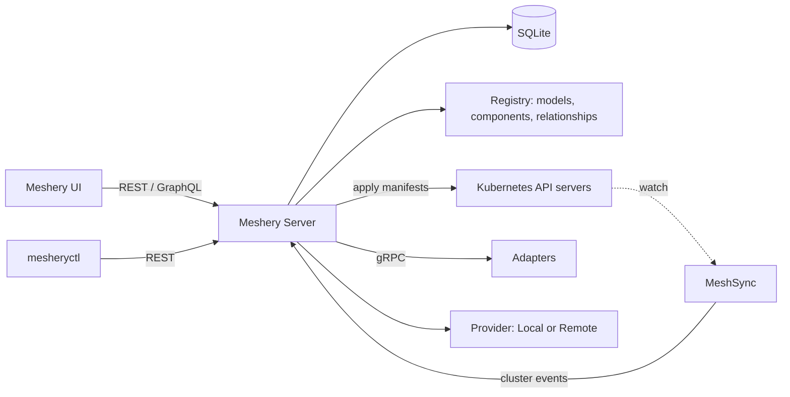

# Architecture

## Big picture

Meshery has one central process, Meshery Server, and everything else is either a client of it or a source of data for it. The UI and `mesheryctl` call its REST and GraphQL APIs. The server talks to each connected Kubernetes cluster directly with a kubeconfig, and it learns what is in those clusters from MeshSync. Optional adapters extend it over gRPC, and a Provider plug-in decides where users, designs and results are stored.

Two terms come up on every page from here on. A **model** describes one technology (Kubernetes itself, Istio, a cloud service) as a set of **components**, which are resource types with a JSON schema, and **relationships**, which say how components connect: parent and child, an edge between two, or a binding through a third. A **design** is the document you write: component declarations plus relationships. The code still calls a design a `PatternFile`, from its earlier name "pattern" ([Logical Concepts](https://docs.meshery.io/concepts/logical)).

## Components

### Meshery Server

The Go process under `server/`. It serves the UI, the REST and GraphQL APIs on port 9081, holds the registry of models, evaluates designs, and deploys them ([Architecture docs](https://docs.meshery.io/concepts/architecture)). Routes are registered in `server/router/server.go`; handlers live in `server/handlers/`.

Its database is a SQLite file, `mesherydb.sql` in the user data folder (`server/models/sql-utils.go:101-105`). The docs describe it as "persisted to file" but "treated as a cache" ([Architecture docs](https://docs.meshery.io/concepts/architecture)).

### Meshery UI and mesheryctl

The UI (`ui/`) is a Next.js application served by the server. `mesheryctl` (`mesheryctl/`) is a Go CLI built with Cobra. Both are clients of the same REST API: `mesheryctl design apply` posts to `/api/pattern/deploy` exactly as the UI does (`mesheryctl/internal/cli/root/design/apply.go:82`).

### MeshSync

MeshSync discovers Kubernetes resources and keeps the server in sync with them. It runs in one of two modes per connection. In **embedded** mode, the default, it runs as a library inside the server process and passes events over an in-memory channel. In **operator** mode the server installs Meshery Operator, MeshSync and a NATS broker into the cluster's `meshery` namespace, and events travel over NATS (`server/models/connections/meshsync_deployment_mode.go:40-45`, `server/models/meshery_controllers.go:392-412`, [Quick Start](https://docs.meshery.io/installation/quick-start)). Either way the server consumes the events with the same handler and writes them to its database (`server/models/meshsync_events.go:246-287`).

### Adapters

Adapters are separate gRPC services for a specific technology, such as meshery-istio or meshery-linkerd. The contract is the `MeshService` in `server/meshes/meshops.proto:7-16`, with calls such as `ApplyOperation`, `Provision` and `StreamEvents`. Each adapter listens on its own port (Istio 10000, Linkerd 10001, and so on) ([Architecture docs](https://docs.meshery.io/concepts/architecture)).

### Providers

A Provider is the plug-in that handles identity, preferences and persistence of designs and results. The `Provider` interface spans `server/models/providers.go:579-780`. The server ships two implementations: the Local provider (`server/models/default_local_provider.go:43`, named `"Local"` at `:84`) and a Remote provider that talks to an external service over HTTPS (`server/models/remote_provider.go:80`).

## How a request flows

Take a design deploy, the operation that turns a document into resources in a cluster: `POST /api/pattern/deploy`.

1. **Routing.** The route wraps the handler in four middlewares: provider, authentication, session, and Kubernetes context. `POST` deploys and `DELETE` undeploys (`server/router/server.go:276-277`). The Kubernetes middleware puts the user's connected cluster contexts into the request context.
2. **Parse.** `PatternFileHandler` reads the design from the request body and the query flags `dryRun`, `skipCRD`, `verify` and `upgrade` (`server/handlers/design_engine_handler.go:45-90`). A design in the old `v1alpha2` format is converted first (`:92-119`). The design is then parsed and **hydrated**: missing component definitions are filled in from the registry (`:121-131`).
3. **Collect clusters.** `_processPattern` takes the auth token and the list of Kubernetes contexts from the request context and generates a kubeconfig for each (`design_engine_handler.go:209-231`).
4. **Run the stage chain.** The design passes through `Format`, `Filler`, `Validator`, and then either `DryRun` or `Provision`, followed by a final step that gathers per-component results (`design_engine_handler.go:257-297`).
5. **Plan.** The `Provision` stage builds a dependency graph from each component's `dependsOn` list and refuses a design with a cycle (`server/models/pattern/stages/provision.go:39-58`, `server/models/pattern/planner/planner.go:95-142`). For an undeploy, the edges are reversed so dependents go first.
6. **Execute in parallel.** Each node of the graph runs in its own goroutine and waits until every dependency has reported. If any dependency failed, the node is skipped and reported as withheld, and the failure propagates to its own dependents (`server/models/pattern/planner/parallel_process.go:86-144`).
7. **Apply.** For each component, the server calls `patterns.Process`, which fans out to every connected cluster in parallel. For components from a non-Kubernetes model it first installs prerequisites such as CRDs or an operator, then calls `k8s.Deploy` (`server/models/pattern/patterns/patterns.go:47-140`). `k8s.Deploy` turns the component into a Kubernetes manifest and applies it with update or delete semantics (`server/models/pattern/patterns/k8s/k8s.go:24-45`).
8. **Report.** The handler records an event and returns the per-component summary as JSON (`design_engine_handler.go:168-197`).

## Key design decisions

- **Push, once.** The server applies resources itself and returns. There is no controller that keeps re-applying the design, so drift in the cluster is visible through MeshSync but is not corrected automatically. This is the main difference from GitOps tools, which pull from Git and reconcile on a loop.
- **Fan out to every cluster.** A deploy goes to all of the user's connected contexts at once, one goroutine per cluster (`patterns.go:72-140`). Multi-cluster deployment is the default path.
- **Keep every outcome.** The provision stage records a result for every component, including ones that were never attempted because a dependency failed (`provision.go:100-134`). A deploy response always tells you what happened to each part.
- **The database is disposable.** SQLite holds cached cluster state and the registry. Users, designs and results belong to the Provider, so the same server can be backed by a local store or a remote service.
- **Agentless by default.** With MeshSync embedded, connecting a cluster installs nothing in it. Operator mode exists for setups that need discovery to run inside the cluster.

## Extension points

- **Models.** Add a directory of component and relationship JSON under `models/`; the server registers every model directory at startup (`server/models/seed_models.go:19`, `:155-175`). This is how most integrations are added.
- **Adapters.** Implement the `MeshService` gRPC contract (`server/meshes/meshops.proto:7-16`) for technology-specific operations.
- **Providers.** Implement the `Provider` interface (`server/models/providers.go:579-780`) to back identity and persistence with your own service.
- **UI extensions.** The UI loads remote React components at runtime ([AGENTS.md](https://github.com/meshery/meshery/blob/68d542afa9e40e15e3d032bf3ed1d10eb2347b62/AGENTS.md)).
