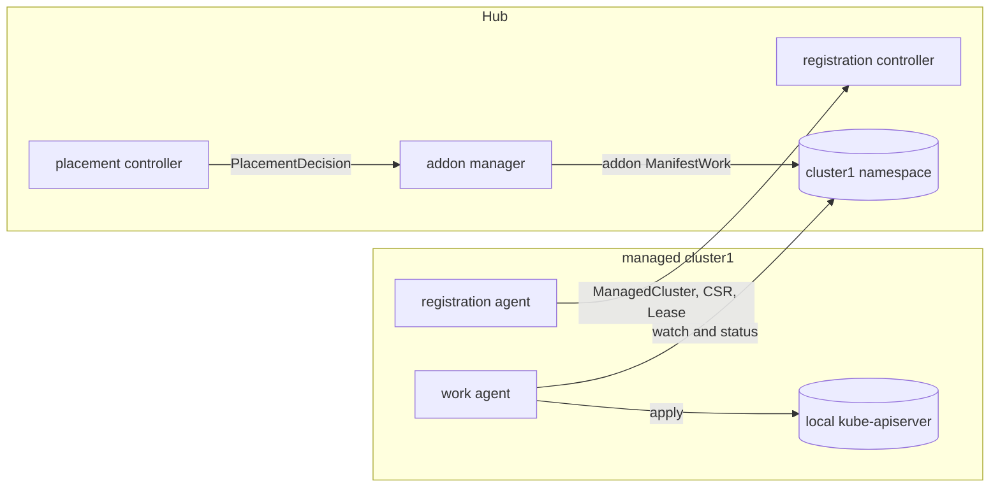

# Architecture

## Big picture

OCM has two sides. The hub is a normal Kubernetes cluster running the Cluster Manager: a set of controllers plus CRDs. Each managed cluster runs the klusterlet, which is two agents, a registration agent and a work agent. The agents connect out to the hub. Delivering work does not require the hub to reach a managed cluster's API server.

The unit of isolation on the hub is a namespace per managed cluster, named after the cluster. When the hub accepts a cluster it creates that namespace and the RBAC that lets the cluster's agents read and update objects in it (`pkg/registration/hub/managedcluster/controller.go:217-260`). Anything addressed to a cluster, such as a ManifestWork or a ManagedClusterAddOn, goes in that namespace. The work agent watches only its own namespace (`pkg/work/spoke/spokeagent.go:257`).

Two more terms appear in the diagram. A certificate signing request (CSR) is the Kubernetes object an agent uses to ask the hub for a client certificate. A Lease is a small `coordination.k8s.io` object the agent renews as a heartbeat. A ManagedClusterAddOn is the per-cluster record that an add-on is enabled on that cluster.

## Components

The hub side commands live in `pkg/cmd/hub/`, the managed cluster side in `pkg/cmd/spoke/`. Both sides are normally installed by an operator.

### Registration

The hub's registration controller accepts or denies clusters, creates the per-cluster namespace and RBAC, approves CSRs, and watches each cluster's heartbeat lease. On the managed cluster, the registration agent creates the `ManagedCluster` object on the hub, obtains a client certificate, renews it, keeps the lease fresh, and reports cluster status and claims (bootstrap flow described at `pkg/registration/spoke/spokeagent.go:88-116`, claims at `pkg/registration/spoke/managedcluster/claim_reconcile.go:33`). Credential handling is pluggable: the CSR driver is the default, with AWS IRSA and gRPC drivers as alternatives (`pkg/registration/register/factory/options.go:80-89`). Add-on agents can authenticate with CSR or a token (`factory/options.go:24-26`).

### Work

The work agent applies `ManifestWork` objects from its hub namespace onto the managed cluster and writes status back. On the hub, a `ManifestWorkReplicaSet` controller fans one ManifestWork template out to every cluster a Placement selects, with a rollout strategy (`vendor/open-cluster-management.io/api/work/v1alpha1/types_manifestworkreplicaset.go:54-103`).

### Placement

The placement controller reads `Placement` objects and writes `PlacementDecision` objects listing the chosen cluster names (`pkg/placement/controllers/scheduling/scheduling_controller.go:214-284`). It does not deploy anything. Consumers read the decisions and act on them. A Placement only sees clusters in ManagedClusterSets (named groups of clusters) that are bound to its namespace with a ManagedClusterSetBinding (`vendor/open-cluster-management.io/api/cluster/v1beta1/types_placement.go:18-26`).

### Add-on manager

The add-on manager deploys add-on agents to managed clusters by wrapping their manifests in ManifestWorks named `addon-<name>-deploy-*` in each cluster's namespace (`vendor/open-cluster-management.io/addon-framework/pkg/addonmanager/controllers/agentdeploy/default_sync.go:29-77`). It runs as `manager` (`pkg/cmd/hub/addon.go:20-21`). Hub credentials for an add-on agent come from the registration agent on the managed cluster, which creates a separate credential driver instance for each add-on and requests a certificate for it (`pkg/registration/spoke/addon/registration_controller.go:223`).

### Operators and install modes

The cluster-manager operator installs the hub components from a `ClusterManager` resource. The klusterlet operator installs the agents from a `Klusterlet` resource (`pkg/operator/operators/`). The klusterlet has four modes: Default, Hosted, Singleton, and SingletonHosted. Singleton runs registration and work as one deployment. Hosted runs the agents on a separate management cluster and leaves only CRDs and configuration on the managed cluster (`vendor/open-cluster-management.io/api/operator/v1/types_klusterlet.go:407-416`).

### gRPC server

An optional hub binary, `server` ("Server for transport resources", `cmd/server/main.go:37-38`), lets agents exchange ManifestWorks and other resources with the hub over gRPC instead of through the hub's kube-apiserver.

## How a request flows

Registration has to finish before any work can flow. Both flows below follow a cluster named `cluster1`.

### Registering a cluster

1. The registration agent starts with a bootstrap kubeconfig, a low-privilege credential for the hub. If it has no valid hub kubeconfig yet, it runs a temporary bootstrap controller (`pkg/registration/spoke/spokeagent.go:276-315`).
2. That controller creates a `ManagedCluster` named after the cluster on the hub if none exists (`pkg/registration/spoke/registration/creating_controller.go:52-92`) and submits a CSR whose subject names the cluster and the agent.
3. On the hub, `validateCSR` checks that the CSR's cluster label, organization, and common name all name the same cluster (`pkg/registration/register/csr/approve_reconciler.go:133-201`). Renewal CSRs from an agent that already joined are approved automatically when the requester is the identity named in the certificate and a SubjectAccessReview allows the renewal (`approve_reconciler.go:60-90`). A first-time CSR is approved automatically only if the alpha `ManagedClusterAutoApproval` feature gate is on and the requester is on the auto-approval list (`pkg/registration/register/csr/hub_driver.go:181-185`, `approve_reconciler.go:108-128`). Otherwise a hub admin approves it.
4. The hub admin sets `spec.hubAcceptsClient: true` on the ManagedCluster (`vendor/open-cluster-management.io/api/cluster/v1/types.go:64`). The hub controller then creates the cluster namespace, a finalizer, and the cluster's RBAC and role bindings (`pkg/registration/hub/managedcluster/controller.go:217-260`). Setting it back to false removes the role bindings and marks the cluster denied (`controller.go:164-215`). With the alpha `ManagedClusterAutoApproval` gate on, the hub sets `hubAcceptsClient` itself the first time a cluster joins (`controller.go:154-162`).
5. With a signed certificate in hand, the agent stops the bootstrap controller and starts its main controllers (`spokeagent.go:328-337`).
6. From then on the agent renews a Lease every `leaseDurationSeconds`, 60 by default (`pkg/registration/spoke/lease/lease_controller.go:67-81`). If the hub sees no renewal for five times that period, it sets the cluster's `ManagedClusterConditionAvailable` to Unknown (`pkg/registration/hub/lease/controller.go:27,115-157`).

This is the "double opt-in" the README describes. By default, the managed cluster admin has to install the agent with a bootstrap credential, and the hub admin has to accept the cluster ([README](https://github.com/open-cluster-management-io/ocm/blob/b4e4b232350d6967008372423e5aa7a967d80a9f/README.md)).

### Applying a ManifestWork

1. Someone (a person, a GitOps tool, the add-on manager, the ManifestWorkReplicaSet controller) creates a ManifestWork in the namespace `cluster1` on the hub.
2. The work agent on `cluster1` sees it through its namespaced informer and reconciles it in `ManifestWorkController.sync` (`pkg/work/spoke/controllers/manifestcontroller/manifestwork_controller.go:132-211`).
3. It creates or updates an `AppliedManifestWork` on the managed cluster, a local record of what this work has applied (`manifestwork_controller.go:213-240`).
4. It sorts the manifests by kind (namespaces and CRDs first, webhooks last) and applies each one with the configured update strategy (`manifestwork_reconciler.go:257-287,321-394`).
5. It patches per-manifest `Applied` conditions and an overall `Applied` condition on the work (`WorkApplied`) back to the hub (`manifestwork_reconciler.go:166-226`).
6. A separate status controller reads the applied resources about every 10 seconds by default (10 seconds plus up to 90% jitter) and copies selected fields back as status feedback (`pkg/work/spoke/options.go:38`, `pkg/work/spoke/controllers/statuscontroller/availablestatus_controller.go:103`).

## Key design decisions

- **Pull, with no cluster credentials on the hub.** The work agent pulls ManifestWorks from its own namespace and applies them locally, so in the default install mode the hub does not hold credentials for managed clusters ([README](https://github.com/open-cluster-management-io/ocm/blob/b4e4b232350d6967008372423e5aa7a967d80a9f/README.md)). Hosted mode is the exception: the cluster that runs the agents keeps a cluster-admin kubeconfig for the managed cluster (`vendor/open-cluster-management.io/api/operator/v1/types_klusterlet.go:409-411`). The cost of pull is latency: changes reach a cluster when its agent sees them, and status comes back on the agent's schedule.
- **A namespace per cluster.** Kubernetes RBAC on the hub does the isolation. An agent's credentials are bound to its own namespace. On the hub side, permission to create ManifestWorks in the namespace `cluster1` is what it takes to send work to `cluster1`.
- **Scheduling and delivery are separate.** Placement only writes a list of cluster names. ManifestWork only delivers to one named cluster. Tools combine them as they like, which is why Argo CD's ApplicationSet generator and RamenDR can consume PlacementDecisions directly ([ADOPTERS](https://github.com/open-cluster-management-io/ocm/blob/b4e4b232350d6967008372423e5aa7a967d80a9f/ADOPTERS.md)).
- **Pluggable transport.** The work agent's `--workload-source-driver` is `kube`, `mqtt`, `grpc`, or `kafka` (`pkg/work/spoke/options.go:56-57`). Anything other than `kube` goes through a CloudEvents client (`pkg/work/spoke/spokeagent.go:212-243`).

## Extension points

- **Add-ons.** An add-on implements the `AgentAddon` interface, mainly a `Manifests` method that returns the objects to deploy on a given cluster (`vendor/open-cluster-management.io/addon-framework/pkg/agent/interface.go:32-49`). An `AddOnTemplate` does the same declaratively, without writing Go (`pkg/addon/templateagent/template_agent.go:80-123`).
- **Placement scores from outside.** Prioritizers can read `AddOnPlacementScore` objects that an add-on writes, so an add-on can feed its own metric into scheduling (`pkg/placement/plugins/addon/addon.go:20-22,82`). A cluster with no score or an expired one scores 0.
- **Cluster claims.** The registration agent copies `ClusterClaim` objects from the managed cluster into the ManagedCluster status (`pkg/registration/spoke/managedcluster/claim_reconcile.go:33`), and Placement can select on them (`vendor/open-cluster-management.io/api/cluster/v1beta1/types_placement.go:217`).
- **Registration drivers.** The `RegisterDriver` and `HubDriver` interfaces (`pkg/registration/register/interface.go:69-94,125-142`) are how the AWS IRSA and gRPC registration paths plug in.
